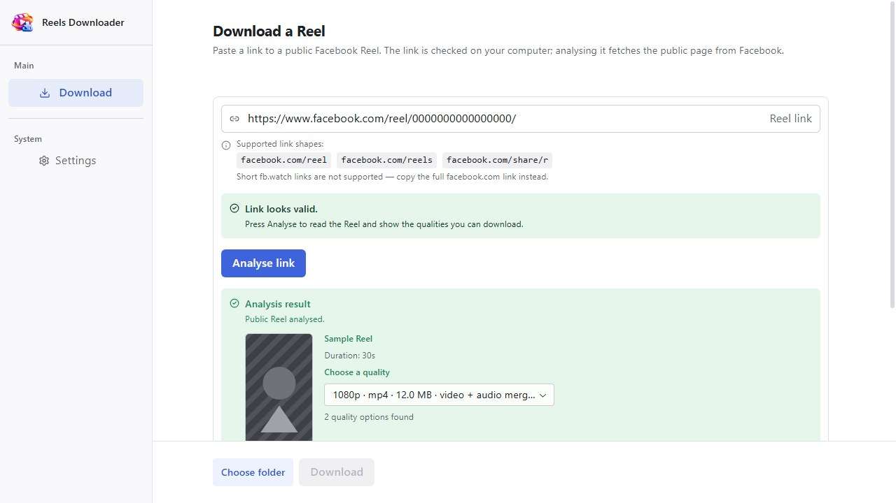
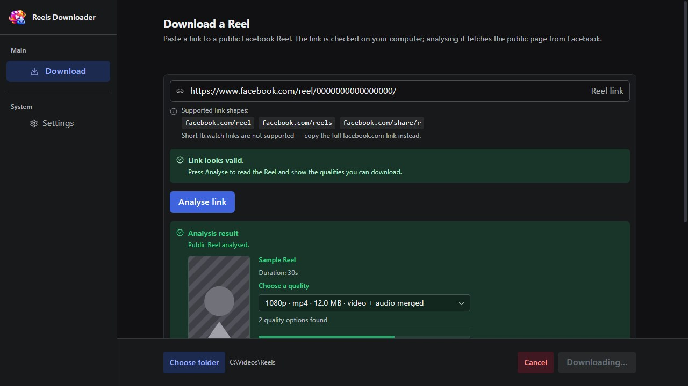
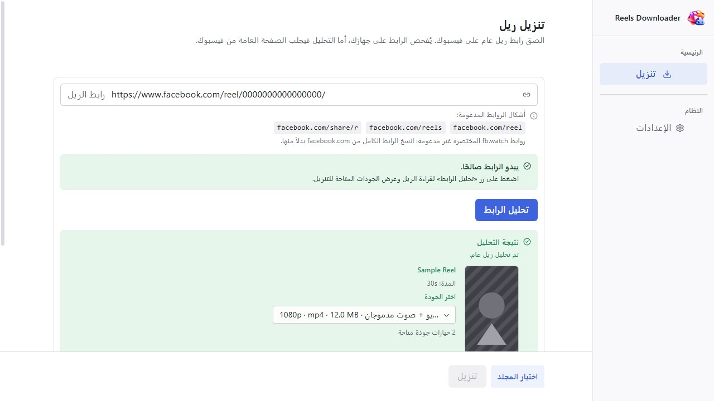

# Reels Downloader

*A free Windows application for downloading public Facebook Reels you have the
right to keep — by Mohamed Farouk Amer.*

**تطبيق مجاني لنظام Windows لتنزيل مقاطع Reels العامة على فيسبوك والتي يحق لك
الاحتفاظ بها.**

[](https://github.com/sliveamer20/Reels-Downloader/releases/latest)
[](https://github.com/sliveamer20/Reels-Downloader/releases)
[](#system-requirements--متطلبات-النظام)
[](LICENSE.txt)

---

## Download / التنزيل

**[Download the latest release →](https://github.com/sliveamer20/Reels-Downloader/releases/latest)**

The official download is the installer published on the **Releases** page. That
is the only supported source — the installer is not code-signed, so the
published SHA-256 is the integrity control, and a copy from anywhere else is
unverified by definition.

التنزيل الرسمي هو ملف التثبيت المنشور على صفحة **Releases**، وهو المصدر
الوحيد المدعوم. ملف التثبيت غير موقَّع برمجياً، لذا فإن بصمة SHA-256 المنشورة
هي أداة التحقق من السلامة، وأي نسخة من مصدر آخر غير متحقَّق منها بحكم التعريف.

| File | Purpose |
|---|---|
| `Reels-Downloader-Setup-<version>.exe` | The installer. Installs for your user account only — no administrator rights required. |

### Screenshots / لقطات الشاشة

| English — light | English — dark | العربية — فاتح |
|---|---|---|
|  |  |  |

## Features / المزايا

- **Real progress, with a rate and a time left.** The download's own progress is
  read from the engine and shown as a bar, the bytes moved of the total, the
  transfer rate and the time remaining — with a Cancel button that stops
  cleanly and leaves no partial file behind.
- **A quality picker.** The analysis lists every quality the page offers; you
  choose one and the app tells you when a rendition will be merged from
  separate video and audio streams.
- **A Reel preview.** The Reel's own preview picture, fetched over HTTPS,
  size-limited and shown before anything is downloaded.
- **Already-downloaded detection.** Asking for a Reel you already have, in the
  same folder, says so instead of downloading it again or overwriting it.
- **Arabic and English, fully mirrored.** The whole interface switches between
  English and Arabic — including the reading direction, so the Arabic layout
  is a right-to-left layout, not a mirrored translation.
- **Mandatory updates.** On launch, before the app opens, it checks GitHub for
  a newer release and installs it. Old versions are not supported by design —
  Facebook changes its pages constantly, and a download tool that cannot be
  updated is a tool that stops working.

**بالإنجليزية:**

- **تقدّم حقيقي مع السرعة والوقت المتبقي وزر إلغاء.** تُقرأ حالة التنزيل من
  المحرّك نفسه وتُعرض كشريط تقدّم مع عدد البايتات المنقولة من الإجمالي وسرعة
  النقل والوقت المتبقي، مع زر إلغاء يوقف العمل بنظافة دون ترك ملف ناقص.
- **منتقي جودات.** يعرض التحليل كل الجودات التي تقدمها الصفحة، وتختار واحدة،
  ويخبرك التطبيق متى كانت الجودة ستُدمج من مجري فيديو وصوت منفصلين.
- **معاينة للريل.** صورة المعاينة الخاصة بمقطع Reel نفسه، تُجلب عبر HTTPS ضمن
  حد للحجم، وتُعرض قبل تنزيل أي شيء.
- **كشف التنزيلات المكررة.** إن طلبت مقطعاً لديك في المجلد نفسه، قال التطبيق
  ذلك صراحةً بدل أن يعيد التنزيل أو يستبدل الملف.
- **عربية وإنجليزية بانعكاس كامل.** تتبدل الواجهة كلها بين العربية والإنجليزية
  — بما في ذلك اتجاه القراءة، فالواجهة العربية تخطيطٌ من اليمين إلى اليسار
  فعلاً، وليست ترجمة معكوسة.
- **تحديثات إلزامية.** عند الإقلاع وقبل فتح التطبيق، يتحقق التطبيق من GitHub
  بحثاً عن إصدار أحدث ويثبّته. الإصدارات القديمة غير مدعومة عمداً — فيسبوك
  يغيّر صفحاته باستمرار، وأداة تنزيل لا يمكن تحديثها هي أداة تتوقف عن العمل.

## Usage / الاستخدام

1. **Paste the link** into the field at the top. The application reads the
   public page and shows what it offers — the picture, the duration, and every
   available quality.
2. **Pick a quality.** Each row shows the resolution and the expected size; a
   video-only quality says so, because it is merged with its audio stream by
   the bundled FFmpeg before it is saved.
3. **Choose the folder** in the action bar at the bottom, then press
   **Download**. The last folder is remembered, so the next Reel is one click.
4. **Watch the progress** in the results panel: the bar, the bytes moved, the
   rate, and the time left. **Cancel** stops the transfer cleanly and removes
   the partial file. When the file is finished, the panel names the file it
   wrote and its size.
5. **Paste the next link** whenever you like — the same page stays open, and
   nothing is downloaded that you did not ask for.

1. **الصق الرابط** في الحقل أعلى الصفحة. يقرأ التطبيق الصفحة العامة ويُظهر ما
   تقدمه: الصورة والمدة وكل الجودات المتاحة.
2. **اختر الجودة.** يعرض كل صف الدقة والحجم المتوقع، والجودة التي لا تحمل صوتاً
   تُعلَّم بذلك صراحةً، لأنها تُدمج مع مجرى الصوت الخاص بها قبل الحفظ.
3. **اختر المجلد** من شريط الإجراءات أسفل الصفحة، ثم اضغط **Download**. يُحفظ
   آخر مجلد، فيصبح الريل التالي نقرة واحدة.
4. **تابع التقدّم** في لوحة النتائج: الشريط والبايتات المنقولة والسرعة والوقت
   المتبقي. و**Cancel** يوقف النقل بنظافة ويحذف الملف الناقص. وعند الانتهاء
   تذكر اللوحة اسم الملف الذي كتبته وحجمه.
5. **الصق الرابط التالي** متى شئت — تبقى الصفحة نفسها مفتوحة، ولا يُنزَّل شيء لم
   تطلبه.

## Supported links / الروابط المدعومة

Three link shapes are read, on the Facebook hosts only:

| Shape | Example |
|---|---|
| Reel permalink | `https://www.facebook.com/reel/<number>` |
| Reels (plural path) | `https://www.facebook.com/reels/<number>` |
| Share path | `https://www.facebook.com/share/r/<token>` |

Hosts accepted: `facebook.com`, `www.facebook.com`, `m.facebook.com`,
`web.facebook.com`. Everything else is refused, and so is any other link
shape — deliberately, so the application never fetches a page it does not
understand.

**`fb.watch` short links are recognised but not downloaded.** The field
reports that the link looks valid, and the application then explains that it
will not follow a short-link redirect and asks for the Reel's permalink
instead. That is deliberate: resolving the short link would mean following a
redirect to a page the application has not allowed, and no request is made.

تُقرأ ثلاثة أشكال من الروابط على مضيفات فيسبوك حصراً: رابط الريل، ومسار
`reels`، ومسار المشاركة `share/r`. كل ما عدا ذلك يُرفض عمداً حتى لا يجلب التطبيق
أبداً صفحة لا يفهمها. أما روابط `fb.watch` القصيرة فيُتعرَّف عليها على أنها صحيحة،
ثم يوضّح التطبيق أنه لن يتبع إعادة توجيهها ويطلب رابط الريل نفسه بدلاً منها.

## System requirements / متطلبات النظام

| Requirement | Value |
|---|---|
| Operating system | Windows 10 or later, 64-bit |
| Architecture | x64 (the installer is 64-bit only) |
| Administrator rights | **Not required** — installs into your own user account's folder |
| Disk space | About 700 MB installed |
| Account or login | Not required, and not accepted — the app never asks for credentials |

## Install / التثبيت

1. Download `Reels-Downloader-Setup-<version>.exe` from the
   [latest release](https://github.com/sliveamer20/Reels-Downloader/releases/latest).
2. **Verify the SHA-256** against the value published with the release (see
   below). In PowerShell:

   ```powershell
   Get-FileHash -Algorithm SHA256 "Reels-Downloader-Setup-<version>.exe"
   ```

   Compare the output with the checksum on the release page and with
   `SHA256SUMS.txt` beside it. If they differ, do not run the file — delete it
   and download again.
3. Run the installer. **Windows SmartScreen** will show a blue "Windows
   protected your PC" window because the installer is not code-signed. That is
   Windows reacting to an unknown publisher, not a report about this file. To
   continue: click **More info**, then **Run anyway**.
4. The application installs for your user account only — no administrator
   rights required — and checks for updates the first time it starts.

فبما أن ملف التثبيت غير موقَّع برمجياً، فقد يعرض Windows نافذة زرقاء تقول
"Windows protected your PC". اضغط **More info** ثم **Run anyway** للمتابعة.
وتحقّق من بصمة SHA-256 قبل تشغيل الملف بمقارنتها بالقيمة المنشورة على صفحة
الإصدار ومع الملف `SHA256SUMS.txt` المجاور لها.

### Verify every published file at once

```powershell
# In the folder where you saved the release files:
foreach ($line in Get-Content SHA256SUMS.txt) {
    $hash, $name = $line -split '  ', 2
    if ((Get-FileHash -Algorithm SHA256 $name).Hash -ne $hash.ToUpper()) {
        Write-Host "MISMATCH: $name"; exit 1
    }
}
Write-Host "All files verified."
```

and on Linux, macOS, or WSL: `sha256sum -c SHA256SUMS.txt`

## Security notes / ملاحظات أمنية

The short version; [`SECURITY.md`](SECURITY.md) is the full policy.

- **Report a vulnerability privately** through GitHub's *Report a security
  vulnerability* link on this repository — never by email, and never as a
  public issue.
- **Verify every download** against the published SHA-256. This application is
  not code-signed, so the published checksum — not the file's icon, its
  publisher name, or where you downloaded it from — is the control that tells
  you a file is the one that was built here.
- **The app contacts three kinds of host and nothing else:** Facebook's public
  pages (to read the Reel you linked), GitHub (once per launch, for the update
  check), and Facebook's image CDN (once per analysed Reel, for its picture).
  It sends no credentials, no cookies, and no telemetry; requests are HTTPS
  only and host-allowlisted.

لإبلاغ عن ثغرة استخدم خاصية الإبلاغ الخاص في GitHub على هذا المستودع، ولا
ترسل بريداً إلكترونياً ولا تفتح مسألة عامة. وتحقّق من بصمة SHA-256 لكل تنزيل:
فالتطبيق غير موقَّع برمجياً، والبصمة المنشورة هي الضمانة الوحيدة على أن الملف
هو الملف الذي بُني هنا. ويتصل التطبيق بثلاثة أنواع من المضيفات فقط — صفحات
فيسبوك العامة، وGitHub لفحص التحديث، وخوادم صور فيسبوك للمعاينة — بلا بيانات
اعتماد ولا ملفات تعريف ارتباط ولا تتبّع.

## FAQ / أسئلة متكررة

**Does it need a login? / هل يحتاج إلى تسجيل دخول؟**

No — and it never accepts one. The application sends no credentials and no
cookies, and has no way to hold a login. If a Reel is not publicly accessible
without an account, this application cannot download it, and it is not designed
to.

لا — ولا يقبل تسجيل دخول أبداً. لا يرسل التطبيق أي بيانات اعتماد أو ملفات
تعريف ارتباط، ولا يمكنه الاحتفاظ بتسجيل دخول. وإن لم يكن المقطع متاحاً للعامة
دون حساب، فلا يمكن لهذا التطبيق تنزيله، وهو غير مصمم لذلك.

**Why are updates mandatory? / لماذا التحديثات إلزامية؟**

On launch, before the application opens, it asks GitHub whether a newer release
exists. Up to date, it opens; a newer version is downloaded, installed, and the
application restarts at the new version — there is no "continue anyway". The
check could not be completed? The application opens with a warning banner, and
nothing stops working. Facebook changes its pages constantly, so a download
tool that cannot be updated is a tool that stops working.

عند الإقلاع وقبل الفتح يسأل التطبيق GitHub عن إصدار أحدث: إن كنت محدَّثاً فتح
التطبيق، وإن وُجد إصدار أحدث نُزِّل وثُبِّت وأُعيد تشغيل التطبيق عليه — بلا
خيار «المتابعة على أي حال». وإن تعذّر إتمام الفحص فُتح التطبيق مع لافتة تحذير
دون توقف أي شيء. فيسبوك يغيّر صفحاته باستمرار، لذا فإن أداة تنزيل لا يمكن
تحديثها هي أداة تتوقف عن العمل.

**Why is there no code signature? / لماذا لا يوجد توقيع برمجي؟**

A code-signing certificate costs money every year and this project has no
revenue. Instead of pretending, the release publishes its SHA-256 in three
places — on the release page, in `SHA256SUMS.txt`, and in this README — so a
modified copy cannot masquerade as the official one.

شهادة توقيع برمجي تكلف مالاً كل عام ولا إيراد لهذا المشروع. بدلاً من ادعاء
غير ذلك، تُنشر بصمة SHA-256 في ثلاثة مواضع — صفحة الإصدار و`SHA256SUMS.txt`
وهذا الملف — فلا تستطيع نسخة معدَّلة أن تتظاهر بأنها النسخة الرسمية.

**What does the app contact, and what is sent? / مع ماذا يتصل التطبيق وماذا يُرسل؟**

1. **Facebook's public web pages** — through the bundled yt-dlp, to read the
   Reel page you linked and to fetch the media it offers. No login, no cookies,
   no credentials of any kind are sent.
2. **GitHub** — once per launch, for the update check. It is what lets GitHub
   see your IP address, and the only thing the check reveals.
3. **Facebook's image CDN** (`*.fbcdn.net`) — once per analysed Reel, for its
   preview picture, size- and time-limited.

Requests are HTTPS-only and host-allowlisted. The application does not report
usage, does not collect telemetry, and does not upload anything.

ثلاثة أنواع من المضيفين ولا شيء غيرهم: صفحات فيسبوك العامة عبر yt-dlp
المضمَّن (دون تسجيل دخول أو بيانات اعتماد)، وGitHub مرة واحدة عند كل إقلاع
للفحص عن التحديث (وهو ما يكشف عنوان IP لـ GitHub فحسب)، وخوادم صور فيسبوك مرة
واحدة لكل تحليل لجلب صورة المعاينة. الطلبات عبر HTTPS فقط وضمن قائمة مضيفين
مسموح بها. التطبيق لا يجمع بيانات الاستخدام ولا يرفع شيئاً.

## Bundled components / المكونات المضمَّنة

| Component | Version | Licence |
|---|---|---|
| yt-dlp | 2026.08.19 | The Unlicense (+ bundled components, see `THIRD_PARTY_NOTICES.md`) |
| FFmpeg | n9.0.2-24-gfd5d616c29-20261009 | GNU LGPL v2.1+, upgraded to v3 by the build |
| Electron | 44.7.0 | MIT |

## SHA-256 for the current release

```
8ec32673ff06a74ac25c2476928943964be3bdbe0e8b1467f80b039747feb002   Reels-Downloader-Setup-0.1.3.exe   174,700,556 bytes
```

This value is regenerated and recorded for every release, and it is quoted on
the release page as well. When the two disagree, take the one on the release
page — see `SECURITY.md` for why the checksum is the control to trust.

## Documents / المستندات

- [`LICENSE.txt`](LICENSE.txt) — the application's licence: proprietary, all
  rights reserved by Mohamed Farouk Amer. Redistribution and commercial use of
  the developer-owned portions are not permitted without the developer's prior
  written permission.
- [`SECURITY.md`](SECURITY.md) — how to verify a download, and how to report
  a security issue privately.
- [`DISCLAIMER.md`](DISCLAIMER.md) — what this tool is, and what it is not.
- [`THIRD_PARTY_NOTICES.md`](THIRD_PARTY_NOTICES.md) — the third-party notices
  for the whole application.
- [`src/resources/FFMPEG-SOURCE-OFFER.md`](src/resources/FFMPEG-SOURCE-OFFER.md)
  — the written offer of FFmpeg's corresponding source, as LGPL v3 section 6
  requires. The two source archives themselves are attached to the release.
- [`CHANGELOG.md`](CHANGELOG.md) — what each release contains.

`LICENSE.txt` and `THIRD_PARTY_NOTICES.md` at the repository root are
byte-identical copies of the files packaged inside every build
(`src/resources/`); a test fails the moment they drift apart.

## Disclaimer / إخلاء المسؤولية

This is a tool. What you download with it, and whether you have the right to,
is your responsibility — see [`DISCLAIMER.md`](DISCLAIMER.md). The application
and its author are not affiliated with, endorsed by, or connected to Meta,
Facebook, or Instagram.

هذه أداة. وما تنزِّلها بها، وما إذا كان يحق لك ذلك، هو مسؤوليتك — راجع ملف
`DISCLAIMER.md`. والتطبيق ومؤلفه غير مرتبطين بأي شكل أو مؤيَّدين من Meta أو
Facebook أو Instagram.

---

## Development

The source is here. To work on it, see [the rest of this file](#development)
below and `docs/RELEASING.md` for the release pipeline.

> Engineering reports are maintained locally and are not included in the public
> repository.
>
> تقارير التطوير محفوظة محليًا ولا يتم تضمينها في المستودع العام.

### Prerequisites

- Node.js >= 22.12.0
- The bundled external binaries are **not** in Git. Before the first run, restore
  them once (offline after the download; nothing is executed by the script):

  ```powershell
  powershell -ExecutionPolicy Bypass -File .\scripts\fetch-resources.ps1
  ```

  Every file is SHA-256 verified against a pinned hash, and the script fails without
  writing anything if a hash does not match. See `src/resources/README.md`.

### Running the code

| Command | What it uses | Rebuilds? |
|---|---|---|
| `run-dev.cmd` | Vite dev server + hot module replacement | No — the dev server serves the current source, `out/` is untouched |
| `run-built.cmd` | The built bundle in `out/` | Yes — builds first, then launches `electron .` |
| `npm run dev` | Vite dev server + hot module replacement | Yes — always serves the current source |
| `npm run start` | The built bundle in `out/` | Yes — `electron-vite preview` builds first |
| `npm run build` | Writes `out/` only | That is its entire purpose |
| `npx electron .` | The built bundle in `out/` | **No** |

**Running `npx electron .` (or any direct Electron launch) uses whatever `out/`
currently contains.** That directory is a build artefact and is gitignored, so a
checkout can carry a stale or partial bundle that still launches and looks like the
app while running older code. Do not run the app that way.

To run the latest code, use `npm run dev` (during development) or
`npm run start` (to exercise a production build). Both rebuild before launching.

On Windows, `run-dev.cmd` and `run-built.cmd` are the double-clickable
equivalents: `run-dev.cmd` goes straight to the dev server, and `run-built.cmd`
rebuilds `out/` before launching `electron .`.

`npm test` runs the offline unit suite — no network request and no child process is
started by any test. `npm run typecheck` and `npm run lint` are the other gates.

### Where things are

```
src/main/         Main process: IPC handlers, network policy, yt-dlp boundary
src/preload/      Restricted contextBridge surface
src/renderer/     React UI
src/shared/       Contracts, validation, and the AR/EN message catalogue
src/resources/    Pinned external binaries (untracked) and their licence files
scripts/          Binary fetch + verification, the release pipeline, the UI harness
tests/unit/       Offline unit tests
docs/             The release pipeline, the publish test, the README screenshots
reports/          Every project and AI-generated report, and the issue log - the
                  only directory reports are written to, and kept local
release-docs/     The operator's release document (not published)
```

Engineering reports are maintained locally and are not included in the public
repository. The directory above is part of a working copy, not of what this
repository publishes.

### Releases and distribution

The release pipeline is documented in `docs/RELEASING.md`. The short version:

| Command | What it does |
|---|---|
| `npm run make:screenshots` | Captures the three README screenshots (1280x720) from a fixture build showing neutral sample content, into `docs/screenshots/`, then restores a clean build |
| `npm run dist` | The full release gate: typecheck, lint, tests, clean rebuild, audit, the installer, the package audit |
| `npm run release:bundle -- --date YYYY-MM-DD` | Stages `release-bundle/v<version>/` — the release assets and the public documents, with the date stamped in — and maintains `distribution/` |
| `npm run release:publish -- --date YYYY-MM-DD` | Publishes to GitHub: the repository settings, the public documents as one commit, the draft release, the uploads in the safe order — then stops for a human confirmation |
| `npm run release:publish -- --date YYYY-MM-DD --publish` | The confirmed second step: publishes the draft as a normal release marked latest |
| `npm run release:publish -- --date YYYY-MM-DD --dry-run` | Prints the whole plan without executing anything |
| `npm run release:publish -- --date YYYY-MM-DD --verify` | The anonymous, unauthenticated checks of the published release |

`distribution/` holds **exactly one file** — the latest installer — so a hand
download from this machine can never pick up the wrong build. The previous
installer is not deleted: `release:bundle` moves it to
`release-archive/v<old-version>/`. Both folders are gitignored.

### Licence

The application is **proprietary software owned by Mohamed Farouk Amer**. See
[`LICENSE.txt`](LICENSE.txt): redistribution, resale, sublicensing and
commercial distribution of the developer-owned portions are not permitted
without the developer's prior written permission, and no open-source licence is
granted for them.

The bundled third-party components are not covered by that notice and keep their
own licences, enumerated in `THIRD_PARTY_NOTICES.md`. FFmpeg's LGPL v3
redistribution obligation is discharged by the written offer in
[`src/resources/FFMPEG-SOURCE-OFFER.md`](src/resources/FFMPEG-SOURCE-OFFER.md)
and by publishing the corresponding source as release assets, where the offer
is published at the top level as `FFMPEG-SOURCE-OFFER.md`. Where applicable law
or a third-party licence requires otherwise, that requirement prevails.

Engineering reports are maintained locally and are not included in the public
repository.

---

Reels Downloader is developed by Mohamed Farouk Amer.